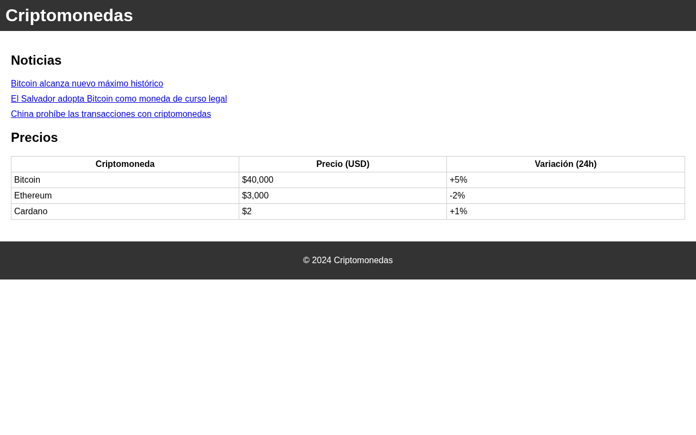

# 🪙 QuipuCash

A static, Spanish-language landing page for cryptocurrency news and prices, built with semantic HTML and plain CSS. It was one of my first front-end projects: the goal was to practice page structure, tables, and basic styling.

🔗 **[Live Demo](https://coderblockch.github.io/QuipuCash/)**



## Features

- Header, main content, and footer laid out with semantic HTML (`header`, `main`, `section`, `footer`)
- **News** section with a list of crypto headlines
- **Prices** table for Bitcoin, Ethereum, and Cardano with price (USD) and 24h change
- Simple, readable styling with a dark header and footer

> **Note:** The headlines and prices are sample data written directly in the HTML. They are not fetched from an API.

## Tech Stack

- HTML5
- CSS3
- JavaScript (`quipu.js`, an early draft of a price chart; see Roadmap)

## Run Locally

No build step or dependencies. Open `index.html` in your browser, or serve the folder:

```bash
git clone https://github.com/coderblockch/QuipuCash.git
cd QuipuCash
python3 -m http.server 8000
# then open http://localhost:8000
```

## Project Structure

```
QuipuCash/
├── index.html   # page markup: news list and prices table
├── style.css    # styles
├── quipu.js     # draft chart script (work in progress)
└── docs/
    └── screenshot.png
```

## Roadmap

- [ ] Load live prices from a public crypto API (e.g. CoinGecko) instead of sample data
- [ ] Finish the price chart in `quipu.js` (it still needs a data-fetching function and the Chart.js library)
- [ ] Make the news links point to real articles

For a finished, API-driven version of this idea, see my **[Crypto Dashboard](https://github.com/coderblockch/crypto-dashboard)**.

## Author

**David Jimenez**, Sacramento, CA · [GitHub @coderblockch](https://github.com/coderblockch) · [Portfolio](https://portfolio-bay-nine-59.vercel.app)
